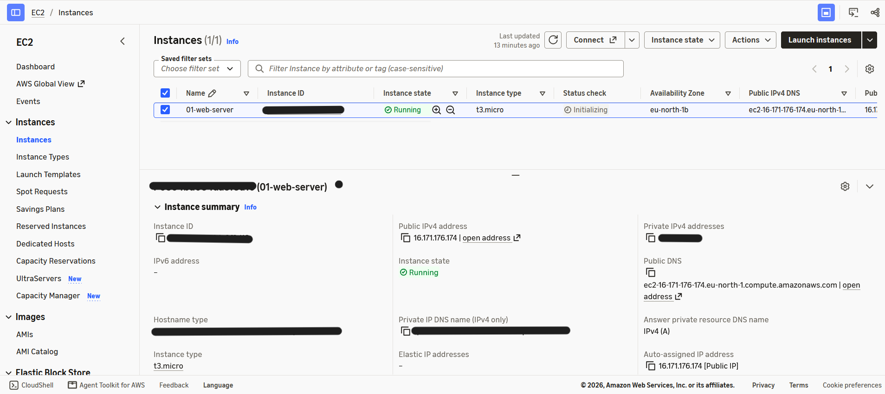
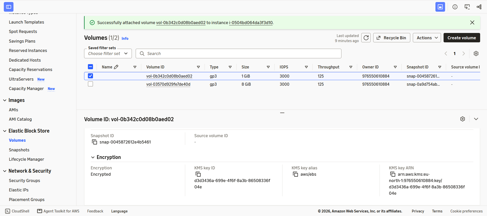
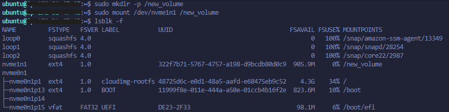
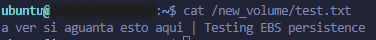
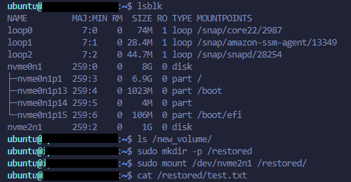
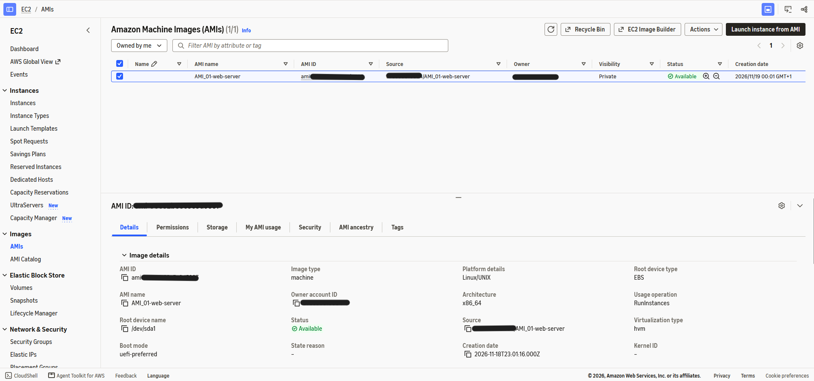
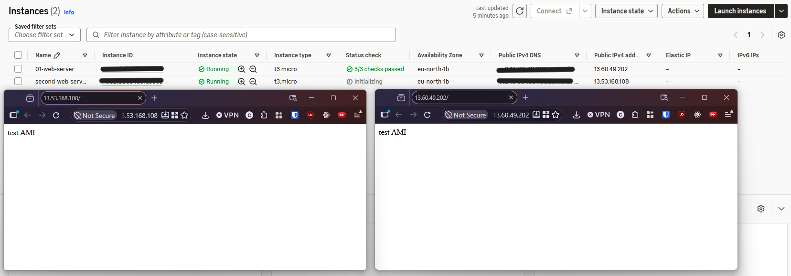
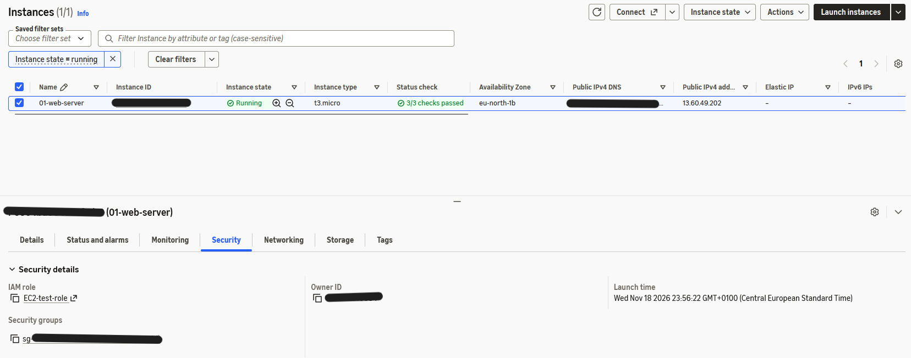
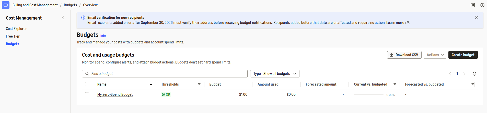

# Project 01 — EC2 Web Server

This repository documents my solution to the project challenge.
The original project requirements and objectives can be found in [PROJECT.md](./PROJECT.md).

## Architecture diagram

## Implementation

### EC2
An EC2 instance running Ubuntu was deployed to host a web server using Apache.

The instance was launched using the [User Data script](./scripts/user-data.sh), which automates the initial web server setup.

A Security Group was created to control inbound traffic:
- HTTP (80): allowed to make the web server publicly accessible.
- SSH (22): allowed only from my public IP address.
- HTTPS (443): not enabled in this stage of the project.

Once the instance was running, I connected to it remotely using SSH and my EC2 key pair. After connecting, I modified the Apache default `index.html` page to display custom content.

### Networking
Although we did not create these networking resources manually, AWS automatically provides a Default VPC in each region allowing us to launch resources without configuring the network infrastructure from scratch.

Our EC2 instance was launched into the Default VPC and assigned to one of its default subnets. This happened because we selected the default networking configuration during instance launch.

The Default VPC already includes the networking components required for internet connectivity:
- VPC & Subnet: provide the network where our EC2 instance runs.
- Internet Gateway (IGW): attached to the Default VPC, allowing communication with the internet.
- Route Table:
    - `172.31.0.0/16` → local: allows communication within the VPC.
    - `0.0.0.0/0` → IGW: routes external IPv4 traffic through the Internet Gateway.
    

The instance also received a public IPv4 address, allowing it to be reached from the internet, subject to its Security Group rules.

### EBS
We created an encrypted EBS volume in a different Availability Zone from our EC2 instance and confirmed that it could not be attached. We then created a snapshot and restored it as a new volume in the correct AZ.

After attaching the volume to our EC2 instance, we formatted it, mounted it, and created a test file.

Finally, we created another snapshot, restored it to a new volume, and verified that the original data was preserved.

### AMI and Instance Replication
We created an AMI from our configured EC2 instance, including its operating system, Apache installation, and custom `index.html`.

We then launched a second EC2 instance using the AMI and verified that both web servers displayed the same content without requiring additional configuration.

### IAM and Security
We created a test IAM Role and attached it to our EC2 instance. IAM Roles allow EC2 instances to access other AWS services securely using temporary credentials, without storing access keys.

For example, an EC2 instance could use a role with `s3:GetObject` permissions to read files from an S3 bucket, following the principle of least privilege.
 

### Cost Management

We monitored resource usage and costs through AWS Billing and configured an AWS Budget alert at $1.

We also learned that some resources, such as EBS volumes and snapshots, can generate costs even when EC2 instances are stopped.

After completing the project, we cleaned up unused EC2 instances, EBS volumes, snapshots, and AMIs to avoid unnecessary charges.