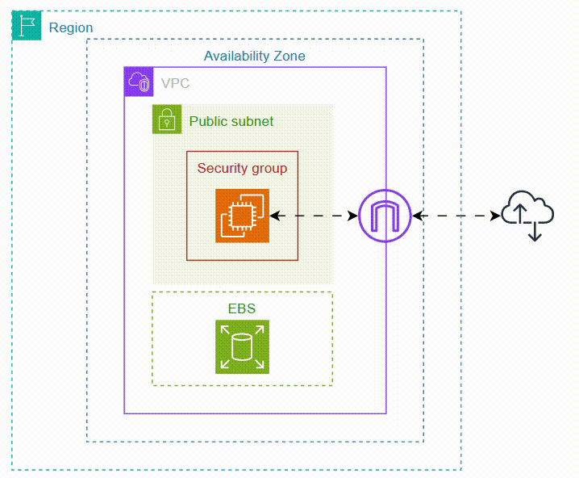
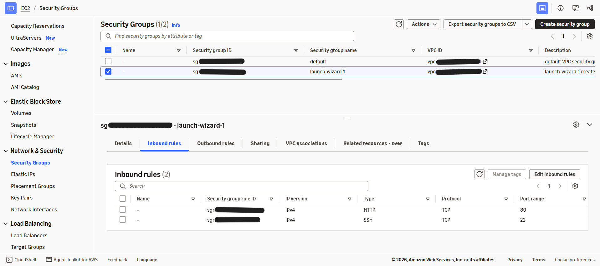
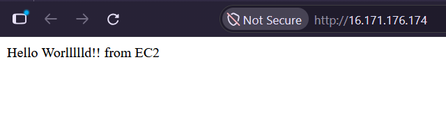
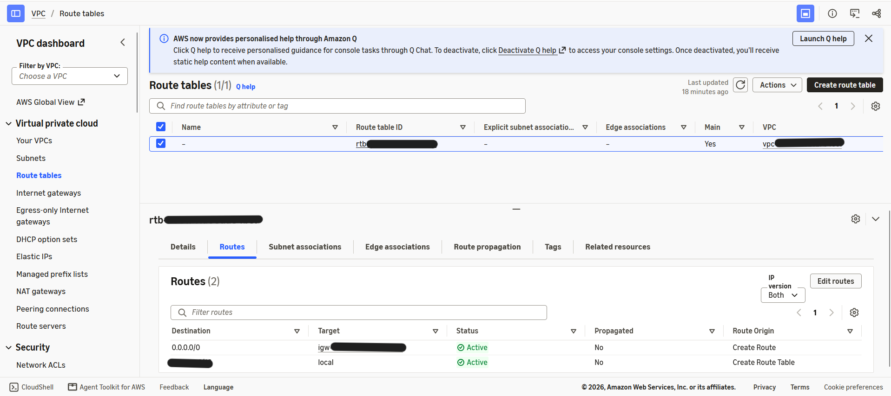

# Project 01 — EC2 Web Server

This repository documents my solution to the project challenge.
The original project requirements and objectives can be found in [PROJECT.md](./PROJECT.md).

## Architecture diagram

## Implementation

### EC2
An EC2 instance running Ubuntu was deployed to host a web server using Apache.

The instance was launched using the [User Data script](./scripts/user-data.sh), which automates the initial web server setup.

A Security Group was created to control inbound traffic:
- HTTP (80): allowed to make the web server publicly accessible.
- SSH (22): allowed only from my public IP address.
- HTTPS (443): not enabled in this stage of the project.

Once the instance was running, I connected to it remotely using SSH and my EC2 key pair. After connecting, I modified the Apache default index.html page to display custom content.

### Networking
Although we did not create these networking resources manually, AWS automatically provides a Default VPC in each region allowing us to launch resources without configuring the network infrastructure from scratch.

Our EC2 instance was launched into the Default VPC and assigned to one of its default subnets. This happened because we selected the default networking configuration during instance launch.

The Default VPC already includes the networking components required for internet connectivity:
- VPC & Subnet: provide the network where our EC2 instance runs.
- Internet Gateway (IGW): attached to the Default VPC, allowing communication with the internet.
- Route Table:
    - 172.31.0.0/16 → local: allows communication within the VPC.
    - 0.0.0.0/0 → IGW: routes external IPv4 traffic through the Internet Gateway.
    

The instance also received a public IPv4 address, allowing it to be reached from the internet, subject to its Security Group rules.

## Testing evidence